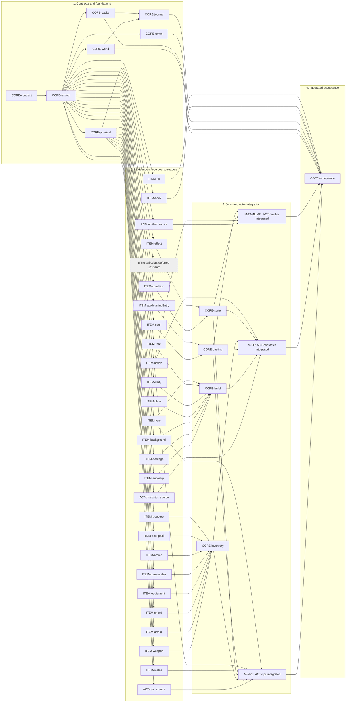

# PF2e Actor and Item development story map

Research audit: **October 20, 2026**. **Status: development in progress; see the [progress record](progress.md).**

Enable a fresh GM-trusted LLM to discover and read characters, NPCs and familiars, and the Items that contribute to them, using rulebook concepts alongside selected source data and canonical identifiers. Current delivery contains **38 stories: 3 Actor types, 23 Item types, and 12 shared tasks**, plus three integration checkpoints inside the Actor stories. The backlog retains 39 stories: dedicated affliction Items are deferred until PF2e maintainers complete that upstream functionality, as explicitly approved October 25, 2026. Deferred work is excluded from delivery progress and is never counted Complete.

Start with [CORE-contract](stories/CORE-contract.md), then CORE-extract. The first useful vertical slice is world NPC discovery/source reading plus action, NPC attack and Lore readers; broader inventory/casting/state integrations can follow. Do not postpone this slice until every Item type or effective-state gate is complete.

Read the [evidence ledger](evidence.md), [research reference](../pf2e-actor-item-reference.md), and [implementation handoff](../prompts/actor-reading-plan.md) before implementation. The ledger records actual rulebook/API/schema reads, corrections and named evidence gates. No new tool behavior, runtime tests, release or deployment is represented by these documents.

## Working conventions

- Stable IDs are filenames and management keys; do not renumber when scheduling changes. Each type has exactly one story. Checklists/checkpoints allow partial delivery without duplicating type stories.
- A story's **planning readiness** is separate from its **implementation status** and **verified capability coverage**. “Source ready” means documentary evidence supports a source milestone after prerequisites, not that a tool exists or its advanced views pass.
- Hard dependencies mean the listed prerequisite checkpoint must be delivered first. Each edge has direction **prerequisite → dependent**. Independent stories in a stage can be implemented in any order.
- **ACT-npc / ACT-character / ACT-familiar graph nodes mean their source checkpoints.** M-NPC / M-PC / M-FAMILIAR are the integrated checkpoints in those same story files, not extra Actor stories. Do not close the whole Actor story merely because its source node passes. Advanced effective sections also require their evidence gates.
- Type readers may return named unresolved references without requiring every referenced type's mapped reader. Optional enrichments below are distinct from hard prerequisites; no recursive reader coupling or dependency cycles.
- Selected source, mapped concepts and supported effective values stay separate, with contributor UUID/source paths and completeness. Core methods/typed declarations alone do not establish supported effective PF2e interfaces.
- Implementation is read-only through the existing Python → authenticated GM browser bridge. No imports, writes, advancement, rolls, casting, activation, chat, enrichment execution, second rules engine or persistent world-state cache.
- Follow repository baseline/focused testing and self-documenting MCP rules. Each story inherits CORE-contract's authorization, bounds, non-PF2e boundary and continuation acceptance. Preserve unrelated work and existing worlds/browser profiles.

### Coverage boundary

Initial Actors: **character, npc, familiar**. Exclude hazard, vehicle, loot, party, army, generic base and unknown/module Actor types from scoped discovery; direct requests return explicit unsupported results. Narrative role/control/pet/companion status is separate from subtype and needs supported evidence.

Relevant Item types each retain a story below. Dedicated affliction Items are outside current delivery; their original requirements remain in ITEM-affliction for future upstream support. They must not block condition/effect delivery or be advertised as readable. Exclude specialized campaignFeature interpretation, generic base and unknown/module types. Unknown types remain explicitly unsupported, never silently equipment. Treasure Items remain included despite loot Actor exclusion. Specialized ritual/flexible/item casting is partial until its contract is established.

### Stages

1. **Contracts and foundations:** identity/authorization, selected extraction, world/pack/token/journal navigation and common physical data. Navigation adapters can proceed independently after extraction.
2. **Independent type readers:** each Actor source checkpoint and each Item's selected-source/deterministic mapping milestone. Physical types use the shared physical helper; kit uses its own bundle schema.
3. **Joins and actor views:** casting/build/inventory/state joins, then the integrated checkpoints owned by Actor stories. Effective-state work proceeds only when its specific evidence gates can close.
4. **Integrated acceptance:** actual MCP descriptions/schemas, complete source-navigation workflows, focused deterministic checks and available existing-runtime verification. Keep unverified capabilities visible.

## Stories and authoritative dependencies

Implementation status is tracked in each story and summarized by `./scripts/actor-tools.sh status`. Readiness below describes research/design state only. A dash in prerequisites means none. Repeated dependency IDs in this table, story headers and Mermaid must agree.

| ID / story | Stage | Planning readiness | Prerequisites | Why required |
| --- | --- | --- | --- | --- |
| [CORE-contract: Shared read contracts, identity and permissions](stories/CORE-contract.md) | 1 | Contract finalized | — | No prerequisite; settle shared contracts and version boundaries first. |
| [CORE-extract: Bounded Actor and Item source extraction](stories/CORE-extract.md) | 1 | Planned | CORE-contract | Uses agreed selectors, permissions, response bounds and error semantics. |
| [CORE-journal: Journal references to Actors and Items](stories/CORE-journal.md) | 1 | Planned | CORE-world, CORE-packs | World and pack discovery/read paths supply valid follow-up targets. |
| [CORE-packs: Scoped Actor and Item compendium discovery](stories/CORE-packs.md) | 1 | Planned | CORE-extract | Adds index/hydration resolution to the shared extraction pipeline. |
| [CORE-physical: Shared physical source fields and attachments](stories/CORE-physical.md) | 1 | Planned | CORE-extract | Applies common physical fields after safe document extraction. |
| [CORE-token: Scene discovery and token-instance resolution](stories/CORE-token.md) | 1 | Planned | CORE-extract | Adds instance-correct resolution to the shared extraction pipeline. |
| [CORE-world: World actor discovery and embedded Item navigation](stories/CORE-world.md) | 1 | Planned | CORE-extract | Lists source identities without waiting for type mapping. |
| [ACT-character: Read character build and supported current views (source checkpoint)](stories/ACT-character.md) | 2 | Source ready; effective views gated | CORE-extract | Uses shared selected-source extraction; referenced types can remain unresolved until their readers are available. |
| [ACT-familiar: Read familiar and master-linked abilities (source checkpoint)](stories/ACT-familiar.md) | 2 | Source ready; effective views gated | CORE-extract | Uses shared selected-source extraction; referenced types can remain unresolved until their readers are available. |
| [ACT-npc: Read NPC and creature stat blocks (source checkpoint)](stories/ACT-npc.md) | 2 | Source ready; effective views gated | CORE-extract | Uses shared selected-source extraction; referenced types can remain unresolved until their readers are available. |
| [ITEM-action: Actions, reactions and passive abilities](stories/ITEM-action.md) | 2 | Ready for source milestone | CORE-extract | Uses shared selected-source extraction; referenced types can remain unresolved until their readers are available. |
| [ITEM-affliction: Affliction definitions and tracked stage](stories/ITEM-affliction.md) | 2 | Deferred upstream; outside delivery | CORE-extract | Future work only after PF2e maintainers complete the type; no current reader or delivery dependency. |
| [ITEM-ammo: Ammunition and explicit selection](stories/ITEM-ammo.md) | 2 | Ready for source milestone | CORE-physical | Uses common physical source rules and identity/bounds. |
| [ITEM-ancestry: Ancestry choices and benefits](stories/ITEM-ancestry.md) | 2 | Ready for source milestone | CORE-extract | Uses shared selected-source extraction; referenced types can remain unresolved until their readers are available. |
| [ITEM-armor: Armor properties and wearing state](stories/ITEM-armor.md) | 2 | Ready for source milestone | CORE-physical | Uses common physical source rules and identity/bounds. |
| [ITEM-background: Background benefit packages](stories/ITEM-background.md) | 2 | Ready for source milestone | CORE-extract | Uses shared selected-source extraction; referenced types can remain unresolved until their readers are available. |
| [ITEM-backpack: Containers and contents](stories/ITEM-backpack.md) | 2 | Source ready; advanced gated | CORE-physical | Uses common physical source rules and identity/bounds. |
| [ITEM-book: Formula and spell books](stories/ITEM-book.md) | 2 | Source ready; advanced gated | CORE-physical | Uses common physical source rules and identity/bounds. |
| [ITEM-class: Class definition and progression](stories/ITEM-class.md) | 2 | Ready for source milestone | CORE-extract | Uses shared selected-source extraction; referenced types can remain unresolved until their readers are available. |
| [ITEM-condition: Conditions and persistent damage](stories/ITEM-condition.md) | 2 | Source ready; advanced gated | CORE-extract | Uses shared selected-source extraction; referenced types can remain unresolved until their readers are available. |
| [ITEM-consumable: Consumables and contained spells](stories/ITEM-consumable.md) | 2 | Source ready; advanced gated | CORE-physical | Uses common physical source rules and identity/bounds. |
| [ITEM-deity: Faith and devotee options](stories/ITEM-deity.md) | 2 | Ready for source milestone | CORE-extract | Uses shared selected-source extraction; referenced types can remain unresolved until their readers are available. |
| [ITEM-effect: Effects, origins and durations](stories/ITEM-effect.md) | 2 | Source ready; advanced gated | CORE-extract | Uses shared selected-source extraction; referenced types can remain unresolved until their readers are available. |
| [ITEM-equipment: General gear and magic item abilities](stories/ITEM-equipment.md) | 2 | Source ready; advanced gated | CORE-physical | Uses common physical source rules and identity/bounds. |
| [ITEM-feat: Feats and acquired features](stories/ITEM-feat.md) | 2 | Source ready; advanced gated | CORE-extract | Uses shared selected-source extraction; referenced types can remain unresolved until their readers are available. |
| [ITEM-heritage: Heritage selections](stories/ITEM-heritage.md) | 2 | Ready for source milestone | CORE-extract | Uses shared selected-source extraction; referenced types can remain unresolved until their readers are available. |
| [ITEM-kit: Bundle definitions](stories/ITEM-kit.md) | 2 | Source ready; advanced gated | CORE-extract | Uses shared selected-source extraction; referenced types can remain unresolved until their readers are available. |
| [ITEM-lore: Lore specialties in Skills](stories/ITEM-lore.md) | 2 | Source ready; advanced gated | CORE-extract | Uses shared selected-source extraction; referenced types can remain unresolved until their readers are available. |
| [ITEM-melee: NPC attacks and Strikes](stories/ITEM-melee.md) | 2 | Source ready; advanced gated | CORE-extract | Uses shared selected-source extraction; referenced types can remain unresolved until their readers are available. |
| [ITEM-shield: Shield properties and state](stories/ITEM-shield.md) | 2 | Source ready; advanced gated | CORE-physical | Uses common physical source rules and identity/bounds. |
| [ITEM-spell: Spell definitions and contextual ranks](stories/ITEM-spell.md) | 2 | Source ready; advanced gated | CORE-extract | Uses shared selected-source extraction; referenced types can remain unresolved until their readers are available. |
| [ITEM-spellcastingEntry: Spellcasting groups and resource sources](stories/ITEM-spellcastingEntry.md) | 2 | Source ready; advanced gated | CORE-extract | Uses shared selected-source extraction; referenced types can remain unresolved until their readers are available. |
| [ITEM-treasure: Valuables and price basis](stories/ITEM-treasure.md) | 2 | Source ready; advanced gated | CORE-physical | Uses common physical source rules and identity/bounds. |
| [ITEM-weapon: Weapon definitions and instance configuration](stories/ITEM-weapon.md) | 2 | Source ready; advanced gated | CORE-physical | Uses common physical source rules and identity/bounds. |
| [CORE-build: Build choices, benefits and acquired-document joins](stories/CORE-build.md) | 3 | Planned | ITEM-ancestry, ITEM-heritage, ITEM-background, ITEM-class, ITEM-deity, ITEM-feat, ITEM-lore | Needs each build contributor plus owned feat/feature and Lore interpretation. |
| [CORE-casting: Spell/group/resource joins](stories/CORE-casting.md) | 3 | Planned | ITEM-spell, ITEM-spellcastingEntry | Needs spell definitions and casting group/resource source records. |
| [CORE-inventory: Inventory containment and source configuration joins](stories/CORE-inventory.md) | 3 | Planned | ITEM-weapon, ITEM-armor, ITEM-shield, ITEM-equipment, ITEM-consumable, ITEM-ammo, ITEM-backpack, ITEM-treasure | Needs common possession/container/ammunition readers; book/kit expansion stays optional. |
| [CORE-state: Conditions and effects provenance joins](stories/CORE-state.md) | 3 | Planned | ITEM-condition, ITEM-effect | Needs condition/effect source identities/status/origins; dedicated affliction support is deferred outside delivery. |
| [CORE-acceptance: Integrated discovery, contracts and compatibility acceptance](stories/CORE-acceptance.md) | 4 | Planned | M-NPC, M-PC, M-FAMILIAR, CORE-world, CORE-packs, CORE-token, CORE-journal, ITEM-book, ITEM-kit | Checks every type baseline, actor integration checkpoint and source/navigation adapter. |

### Actor integration checkpoints

| Checkpoint / owning story | Prerequisites | Why required |
| --- | --- | --- |
| [M-NPC — ACT-npc](stories/ACT-npc.md) | ACT-npc, CORE-casting, CORE-inventory, CORE-state, ITEM-melee, ITEM-action, ITEM-lore | Adds authored attacks, abilities, Lore, casting, inventory and state to NPC source reading. |
| [M-PC — ACT-character](stories/ACT-character.md) | ACT-character, CORE-build, CORE-casting, CORE-inventory, CORE-state, ITEM-action | Adds build, actions, casting, inventory and state to character source reading. |
| [M-FAMILIAR — ACT-familiar](stories/ACT-familiar.md) | ACT-familiar, ITEM-action, CORE-state, CORE-casting | Adds familiar abilities, optional sourced casting and state; master lookup uses shared extraction, not full PC mapping. |

### Optional relationships, not hard prerequisites

| Enhancement | Available after | Baseline behavior before enhancement |
| --- | --- | --- |
| Map a consumable’s contained spell | ITEM-consumable + ITEM-spell | Selected contained source with source-path identity; no invented embedded UUID |
| Expand book content or kit components in inventory | CORE-inventory + ITEM-book / ITEM-kit | Named source references; no automatic possession or preparation inference |
| Follow journal token-instance references | CORE-journal + CORE-token | Typed reference with explicit resolution limitation |
| Explain a familiar’s master with a full PC view | ACT-familiar + ACT-character | Permission-aware master identity/selected source via CORE-extract |
| Cross-source end-to-end type reads | Type reader + CORE-packs / CORE-token | World/embedded source reading remains usable |
| Advertise effective/current statistics | Owning story + its evidence gate | Explicit source/partial/unsupported effective section |

## Dependency flowchart

Solid arrows are the direct hard dependencies in the tables above. Transitive prerequisites are not repeated at final acceptance: the three Actor integration checkpoints already cover the other Item readers; book and kit remain explicit. Labels retain stable story IDs; ACT labels explicitly say source. Integration nodes belong to their Actor story. This is a development dependency graph, not a runtime recursion graph.

## Completion and management

- Track source and integrated checkpoints separately in each Actor story. For Item stories, keep advanced gates open after source mapping ships; list delivered/partial/unsupported sections explicitly. Evidence gates are external readiness conditions, not fabricated prerequisite stories or runtime features.
- Preserve the [named gates and compatibility baseline](evidence.md#open-verification-gates): current effective PC/familiar values, casting resources, state activity/expiry, specialized live Items, grant/folder contracts and v13 pairing remain unverified.
- On story changes, update the owner checklist, dependency table and Mermaid together; use real prerequisite edges, not preferred ordering. Keep IDs stable when moving stages.
- To close implementation acceptance, validate actual discovery/schema/runtime contracts, focused Python/JS fixtures and existing-runtime checks specified by the story. Run the full offline suite before any implementation commit. Source-only evidence cannot certify deployment behavior.
- This documentation change requires link/type/dependency/cycle/diagram/whitespace checks. It does not require game setup or application regression tests. No automatic release or Docker Hub publication.
