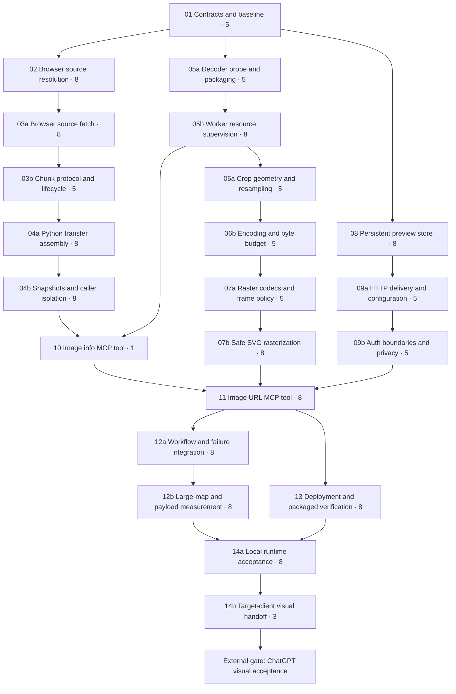

# Foundry image viewing: unattended implementation plan

Implement the two tools and private preview service specified in the
[source design](../../prompts/foundry-image-previews-plan.md). This directory
breaks that design into independently tested local commits. No feature work has
been completed merely by creating this plan.

## Start and recover context

Before starting, and **immediately after every context compression, session
resume, or handoff**, reopen and read these files **in full** before selecting
the next action:

1. [Planning assignment snapshot](../../prompts/foundry-image-viewing-task-breakdown-plan.md)
2. [Authoritative feature design](../../prompts/foundry-image-previews-plan.md)
3. This index and the current task file, including its dependencies' evidence.
4. [Repository instructions](../../../AGENTS.md) and their required reading.

This rule applies both to the agent maintaining these planning documents and
the agent implementing the feature. A compressed summary is not a substitute.
Reconcile the current diff, Git history, test evidence, and task records before
resuming. The design's reviewed commit is a reference, not a reset instruction;
start from the current checkout and preserve unrelated changes.

Use this kickoff instruction for the implementation agent:

> Implement `docs/plans/image-viewing/README.md`. Read its context-recovery
> instructions and both referenced prompts in full before starting. Complete
> ready tasks with their unit tests and separate local commits. After every
> context compression or resume, reread those files and the current task from
> disk before continuing. Record unavailable external checks precisely and
> continue independent authorized work.

## Dependency graph and checkpoints

Direct dependencies are listed below; their ancestors are also prerequisites.
Default execution is a single agent, in the table's order (a before b).
If a task cannot proceed,
take the lowest numbered ready independent task. The graph does not authorize
spawning agents or concurrent writes to this checkout.

| ID and task | Points | Direct dependencies | Implementation status | Commit |
| --- | --- | --- | --- | --- |
| [01 Contracts and baseline](tasks/01-contracts-and-baseline.md) | 5 | None | Not started | — |
| [02 Browser source resolution](tasks/02-browser-source-resolution.md) | 8 | 01 | Not started | — |
| [03a Browser source fetch](tasks/03a-browser-source-fetch.md) | 8 | 02 | Not started | — |
| [03b Chunk protocol and lifecycle](tasks/03b-chunk-protocol-and-lifecycle.md) | 5 | 03a | Not started | — |
| [04a Python transfer assembly](tasks/04a-python-transfer-assembly.md) | 8 | 03b | Not started | — |
| [04b Snapshots and caller isolation](tasks/04b-private-snapshots-and-caller-isolation.md) | 8 | 04a | Not started | — |
| [05a Decoder probe and packaging](tasks/05a-decoder-probe-and-packaging.md) | 5 | 01 | Not started | — |
| [05b Worker resource supervision](tasks/05b-worker-resource-supervision.md) | 8 | 05a | Not started | — |
| [06a Crop geometry and resampling](tasks/06a-crop-geometry-and-resampling.md) | 5 | 05b | Not started | — |
| [06b Encoding and byte budget](tasks/06b-preview-encoding-and-byte-budget.md) | 5 | 06a | Not started | — |
| [07a Raster codecs and frame policy](tasks/07a-raster-codecs-and-frame-policy.md) | 5 | 06b | Not started | — |
| [07b Safe SVG rasterization](tasks/07b-safe-svg-rasterization.md) | 8 | 07a | Not started | — |
| [08 Persistent preview store](tasks/08-persistent-preview-store.md) | 8 | 01 | Not started | — |
| [09a HTTP delivery and configuration](tasks/09a-http-delivery-and-configuration.md) | 5 | 08 | Not started | — |
| [09b Auth boundaries and capability privacy](tasks/09b-auth-boundaries-and-capability-privacy.md) | 5 | 09a | Not started | — |
| [10 Image info MCP tool](tasks/10-image-info-mcp-tool.md) | 1 | 04b, 05b | Not started | — |
| [11 Image URL MCP tool](tasks/11-image-url-mcp-tool.md) | 8 | 07b, 09b, 10 | Not started | — |
| [12a Workflow and failure integration](tasks/12a-workflow-and-failure-integration.md) | 8 | 11 | Not started | — |
| [12b Large-map and payload measurements](tasks/12b-large-map-and-payload-measurements.md) | 8 | 12a | Not started | — |
| [13 Deployment and packaged verification](tasks/13-deployment-and-packaged-verification.md) | 8 | 11 | Not started | — |
| [14a Local runtime acceptance](tasks/14a-local-runtime-acceptance.md) | 8 | 12b, 13 | Not started | — |
| [14b Target-client visual handoff](tasks/14b-target-client-visual-handoff.md) | 3 | 14a | Not started | — |

Task files name intended local commit subjects. Each task's implementation,
unit tests, relevant documentation, and evidence must be committed together;
never defer its tests to task 12a. Foundation code may remain internal until the
tool tasks register it; do not publish placeholder MCP tools.

## Relative estimates and splits

Points combine implementation effort, test/verification effort, and technical
uncertainty relative to this task set; they are not hours. Allowed values are
1 (small isolated change), 3 (bounded addition), 5 (moderate subsystem change),
8 (substantial change with one cohesive boundary), and 13 (too broad for one
checkpoint). Task 10 is the 1-point anchor because its source/probe/auth services
and registration/testing patterns are supplied by completed dependencies.
The external client's availability is recorded as a prerequisite, not estimated
waiting time. The external visual gate itself is not an implementation task.

The initial sizing found eight 13-point tasks. Each has been replaced by two
smaller tasks with its own tests and local commit; the parent ID is retained only
for this before/after mapping. No executable 13-point parent remains. Task IDs
such as 13 are identifiers, separate from point values.

| Original task | Before | After, with points |
| --- | --- | --- |
| 01 Contracts and baseline | 5 | 01: 5 |
| 02 Browser source resolution | 8 | 02: 8 |
| 03 Browser byte transfer | 13 | 03a Fetch: 8; 03b Chunk protocol: 5 |
| 04 Snapshots and caller isolation | 13 | 04a Assembly: 8; 04b Snapshots: 8 |
| 05 Isolated decoder and metadata | 13 | 05a Probe/packaging: 5; 05b Supervision: 8 |
| 06 Crop geometry and encoding | 13 | 06a Geometry: 5; 06b Encoding: 5 |
| 07 Formats and SVG safety | 13 | 07a Raster codecs: 5; 07b SVG safety: 8 |
| 08 Persistent preview store | 8 | 08: 8 |
| 09 HTTP and capability privacy | 13 | 09a HTTP/configuration: 5; 09b Auth/privacy: 5 |
| 10 Image info tool | 1 | 10: 1 |
| 11 Image URL tool | 8 | 11: 8 |
| 12 Workflow/failure integration | 13 | 12a Workflows: 8; 12b Large-map/measurements: 8 |
| 13 Deployment/package verification | 8 | 13: 8 |
| 14 Local acceptance/handoff | 13 | 14a Local acceptance: 8; 14b Visual handoff: 3 |

Result: **14 tasks / 142 points before; 22 tasks / 140 points after**. Maximum
task size falls from 13 to 8. Split estimates are made independently rather than
forced to sum to the parent's estimate; the slight total change is estimation
refinement, not a claim of reduced feature scope or guaranteed time savings.

## Per-task execution protocol

1. Perform context recovery above. Inspect status/diff and verify dependency
   commits. Use the code graph for local structure, current source for truth,
   and versioned Grounded Docs for Foundry public contracts.
2. Read the task's linked sections and implement its smallest complete boundary.
   Establish tests for behavior being extended before changing it. Reproduce
   unexpected behavior with a failing unit test before fixing it.
3. Run listed focused checks after meaningful edits. All tests, including
   test-running hooks and verification harnesses, require the command tool's
   `sandbox_permissions: "require_escalated"` from their first invocation.
   Preserve approval protections; report denied execution rather than weakening
   assertions. Provision dependencies separately with `uv sync --locked`.
4. Run `./scripts/test.sh` before every implementation commit. Resolve relevant
   failures before dependent work. Markdown-only evidence commits follow the
   repository's staged-path exception and still need link/consistency checks.
5. Use the development-loop skill for module changes: after focused tests,
   refresh only the dedicated development tab, wait for bridge readiness, and
   inspect console/live behavior. Use connection guidance if needed. If runtime
   access is missing, record the precise check and continue independent work;
   mocks do not prove Foundry compatibility.
6. Stage explicit task paths with plain `git add`, inspect the staged diff and
   whitespace, then run plain `git commit`. Do not push, tag, release, bypass
   hooks, or include unrelated edits. The task request authorizes these local
   implementation commits. This plan does not authorize publication.
7. Record implementation status, checks, measurements, and gaps in the task and
   index. In its own commit, identify the task commit as `this commit`; the next
   task resolves that reference to its SHA using Git history. A commit cannot
   contain its own final SHA. Record literal SHAs for predecessors and resolve
   the final task in the final report without an endless amend cycle.

After three unsuccessful diagnosis/fix attempts on one issue, stop and report
the evidence and required input per AGENTS.md. Do not switch tasks to evade that
stop requirement. Otherwise continue until all independent authorized work is
complete. Do not invent passing results when services are unavailable.

Keep command approvals easy to review: use short, plain commands and existing
fixed runners where available. Put necessary reusable verification logic in
readable, tested harness files with documented bounds. Avoid large inline
Python or shell programs in approval requests, and keep file edits separate
from verification commands.

## Interfaces and fixed budgets

The source design owns the exact public fields and semantics. Task 01 defines
shared models; tasks 10/11 expose them through actual FastMCP discovery and
invocation with OAuth metadata. Both tools use existing canonical selectors or
bare stored references without a mandatory prior browse. Only the URL tool
accepts `source_id` and `crop`. Private byte-transfer RPCs are not MCP tools.

| Boundary | Required budget or lifetime | Owner |
| --- | --- | --- |
| Original source | 128 MiB compressed; 32,768 pixels/edge; 128,000,000 pixels | 03a, 04a, 05a |
| Transfer | At most 32 KiB raw/chunk; at most 16 in flight; fit configured frames including envelope/base64 (65,536-byte default) | 03b, 04a |
| Transfer deadlines | 15 seconds per stalled read; 5 minutes total | 03a–03b, 04a |
| Private source snapshots | 30 minutes from staging; 512 MiB total | 04b |
| Delivered raster | 2,048 pixels/edge; 2,359,296 pixels; 2 MiB encoded; no enlargement | 06a–06b, 07a–07b |
| Preview worker | One render at a time; 1 GiB resident memory; 2 GiB private scratch; 90 seconds/render | 05b |
| Public derivative | Exactly 604,800 seconds from publication; fresh UUIDv4 per issuance | 08, 09a |
| Live derivative store | 1 GiB and 4,096 rows; prune expired records before rejecting issuance | 08 |

Keep quotas and clocks injectable for tests without weakening production
defaults. Plain unauthenticated mode cannot issue links. Authenticated image
info works without a preview origin. Already-issued public images remain
readable without a connected GM until their own expiry.

## Requirement coverage and final gates

| Source-design requirement | Implementation | Acceptance evidence |
| --- | --- | --- |
| Strict inputs, exact outputs, discoverable recovery, OAuth metadata | 01, 10–11 | Actual MCP tests in 10–11, 12a |
| Exact selectors, bare references, bounded parent search, escaping and S3 boundary | 02, 03a | Resolver/bridge tests; live local paths in 14a; live S3 only if configured |
| Immutable bounded transfer, socket/world/GM checks, private bytes | 03a–03b, 04a | Fault/cancellation/concurrency tests; real multichunk workflow in 12a |
| Caller-bound snapshots, replacement bytes, expiry, membership recheck | 04b, 10–11 | Identity and replacement workflows in 12a |
| libvips isolation, format/size probe, resource enforcement | 05a–05b | Worker tests; measured large map in 12b; packaged checks in 13 |
| Exact crop coordinates, orientation, resizing/encoding, alpha and metadata | 06a–06b | Independent pixel assertions, all orientations, both large-map shapes in 12b |
| Safe SVG, advertised codecs, first-frame policy | 07a–07b | Fixtures in worker and shipped service-user image in 13 |
| Immutable anonymous seven-day GET/HEAD, expiry, quota, persistence | 08, 09a | App tests in 09a/12a; real curl and restart in 13/14a |
| Authenticated issuance, trusted origin, private storage, secret-free logs | 04b, 09a–09b, 10–11 | Auth matrix/log assertions in 09b/12a; proxy examples in 13 |
| Fresh journal fragment reconstruction and browse portrait workflow | 10–11, 12a | Actual MCP workflow and development runtime in 14a |
| Discovery/payload baseline and comparable final measurements | 01, 12b, 14a | Bounded scripts, calls/bytes/completion, catalog delta |
| Public/operator guidance and synchronized module upgrade instructions | 10–11, 13 | Examples, links, discovery prose, packaged checks |
| Target ChatGPT reads pixels and controlled query comparison | 14b external gate | Only a demonstrated target-client result qualifies |

Local completion requires all task implementations committed, required offline
checks passing, and available local/package evidence recorded. Keep three facts
separate: implementation completion, local verification, and target ChatGPT
visual acceptance. A missing live prerequisite leaves that evidence pending;
it does not turn an unverified implementation into verified support.

For visual acceptance, a public HTTPS deployment and the target ChatGPT client
must be available. The client must identify information present only in a crop,
with expected answers held privately, and run the exact-link/query-variant
comparison in equivalent fresh contexts. If unavailable, task 14b supplies the
precise prerequisite and prompt and leaves this external gate pending. HTTP
success alone is not visual acceptance.

Reuse the root development instance, dedicated profile, and `test` world.
Create only safe marked temporary assets/documents with bounded cleanup after
offline checks; preserve existing game assets. Do not create another Foundry
instance, alter Auth0 tenants, publish deployments, or bump release versions.
Keep raw game data, capability tokens, signed URLs, private expected answers,
and bulk fixtures outside transcripts and tracked evidence.
