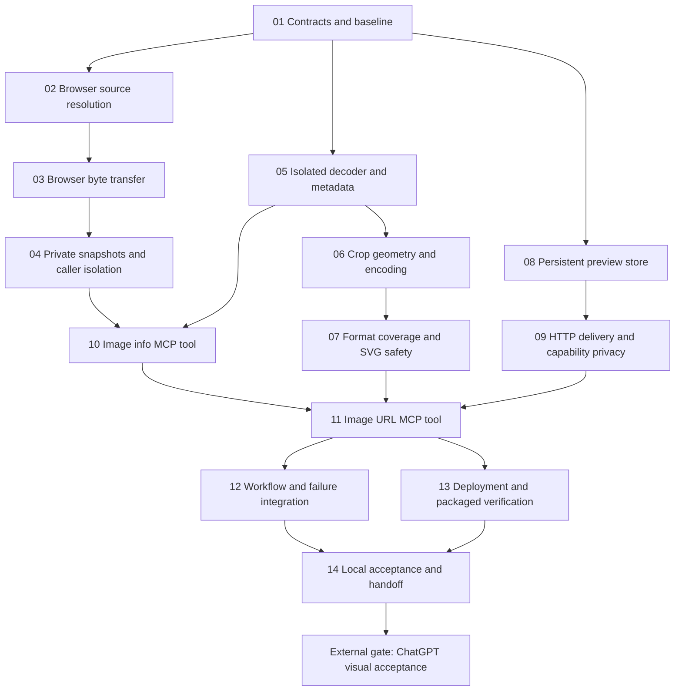

# Draft the unattended image-viewing implementation plan

This is the saved planning assignment approved in the conversation. It directs
creation of planning documents; the feature design remains in
[foundry-image-previews-plan.md](foundry-image-previews-plan.md).

## Sizing amendment — 2026-11-11

The user subsequently requested a relative estimate of 1, 3, 5, 8, or 13 points
for every task, splitting every 13-point task into smaller tested/committed
tasks, and a before/after report in chat. The original fourteen-task assignment
and diagram below are preserved as historical context. For the current task
files, dependencies, estimates, and execution order, use the
[current implementation index](../plans/image-viewing/README.md), including its
relative-estimates table. It supersedes the historical task count and graph.

The original 14 tasks were estimated at 142 points. Eight 13-point tasks (03,
04, 05, 06, 07, 09, 12, 14) were each split into a/b tasks, yielding 22 executable
tasks totaling 140 points, each at most 8. Each child retains its own tests,
acceptance criteria, context recovery, and separate local commit. Preserve all
feature-design requirements; points estimate effort/uncertainty, not hours or
external waiting time. Do not execute historical parent tasks in addition to
their replacements. All context-recovery instructions below still apply.

## Preserve planning context

Before drafting task files, the build agent must snapshot this complete planning
assignment into `docs/prompts/foundry-image-viewing-task-breakdown-plan.md`.

Immediately after **every context compression, session resume, or agent handoff**,
the agent producing these planning documents must reopen and reread in full:

1. `docs/prompts/foundry-image-viewing-task-breakdown-plan.md`
2. `docs/prompts/foundry-image-previews-plan.md`
3. The current planning index and relevant task drafts, if already created.

Recover these paths from the kickoff instructions. Reconcile the current diff and
completed work before continuing. Summaries do not replace rereading either
prompt. Recheck the source design's details against each relevant task so
requirements do not disappear during decomposition.

Carry an equivalent rereading requirement into the finished implementation-plan
README and every task file: the implementation agent must reread both prompts,
the plan index, and its current task after compression or resume.

## Deliverables

Create `docs/plans/image-viewing/README.md` and fourteen task files under
`docs/plans/image-viewing/tasks/`.

The README must contain the dependency diagram, linked task/status table,
execution rules, completion criteria, and commit checkpoints. The source
image-preview design remains authoritative; preserve its interfaces, limits,
security requirements, and acceptance criteria.

Each implementation task must include meaningful unit tests and finish in its
own local commit with passing required checks. Include documentation updates
with the behavior they describe.

Independent branches indicate dependency freedom. Default to one implementation
agent executing serial commits.

## Task breakdown

Create these files under `tasks/`. Expand each into concrete implementation
instructions and tests, cross-checking the complete source design.

| File | Required behavior and tests |
| --- | --- |
| `01-contracts-and-baseline.md` | Strict typed requests/responses, existing `ImageSelector` reuse, exact public result fields, exclusive input forms, shared limits, and actionable errors. Test validation and characterize existing browse/journal behavior. Capture bounded actual MCP discovery and response-size baselines before changing tools; record public-API evidence requirements. |
| `02-browser-source-resolution.md` | Canonical and bare-reference resolution using fresh bounded parent listings and the existing resolver. Test local/S3 mocks, Unicode, spaces, escaping, route prefixes, cache suffixes, ambiguity, listing failures, traversal, unrelated URLs, and permission changes. No recursion or exposure of signed source information. |
| `03-browser-byte-transfer.md` | Private begin/chunk/release RPCs, bounded streaming fetch, immutable transfer bytes, frame/window bounds, socket/world/GM ownership, deadlines, and cleanup. Test credential policy, redirects, absent/dishonest lengths, malformed chunks, ownership changes, cancellation, timeout, and disconnect. Preserve separate PDF authorization. |
| `04-private-snapshots-and-caller-isolation.md` | Python assembly, source digesting, private staging, and 30-minute caller-bound handles. Derive identity from trusted authenticated context. Test chunk coverage/order/failure, cache bounds, expiry, concurrency, principal isolation, and cleanup. Recheck membership before issuance while preserving pinned bytes after source replacement. |
| `05-isolated-decoder-and-metadata.md` | Pin pyvips and native dependencies; implement isolated probing and worker lifecycle. Enforce original-size, memory, scratch, concurrency, and deadline limits separately from uploads. Test metadata, all EXIF orientations, malformed/oversized sources, termination, and cleanup. Preserve Pillow upload behavior and smoke-test the image as UID 10001. |
| `06-crop-geometry-and-encoding.md` | Display-oriented extraction, strict contained rectangles, aspect-preserving sizing, Lanczos3, alpha/color handling, metadata removal, and the specified PNG/WebP/reduction sequence. Test independent pixel expectations, native-size/border/one-pixel crops, rotation/mirroring, transparency, fallback, actual dimensions, and all output budgets. |
| `07-format-coverage-and-svg-safety.md` | Required raster formats and first-frame/page policy; bounded self-contained SVG with 96-DPI/viewBox sizing and local fragments. Test malformed/unsupported content and rejection of script, external resources, file access, and unsafe constructs. Verify shipped-image codec coverage using fixtures. |
| `08-persistent-preview-store.md` | Transactional SQLite publication, fresh UUIDv4 capabilities, token digests, immutable derivatives, format binding, and seven-day expiry. Test atomic failures, concurrent quotas, pruning, exact expiry with cleanup paused, distinct issuances, and restart persistence. Originals and scratch remain outside public storage. |
| `09-http-delivery-and-capability-privacy.md` | GET/HEAD before the final MCP mount, trusted HTTPS origin, storage lifecycle, and capability-safe logs. Test exact headers/bytes, empty HEAD, generic 404s, query-independent lookup, no redirects/login/cookies, and retrieval after GM disconnect. Verify authentication boundaries and protection of MCP, bridge, and PDF routes; test trace/log redaction. |
| `10-image-info-mcp-tool.md` | Actual FastMCP registration and OAuth metadata for `get_foundry_image_info`. Integrate resolution, staging, and probing. Test discovery schemas and invocation, authenticated GM requirements, operation without public origin, errors, and absence of private transfer data or URLs in results. |
| `11-image-url-mcp-tool.md` | Actual registration of `get_foundry_image_url`; compose source staging/reuse, authorization, rendering, and publication. Reject disabled issuance before source processing. Test all input forms, overview/crops, one-transfer reuse, replacement snapshots, expired handles, distinct URLs, quotas, cleanup, and complete public tool guidance. |
| `12-workflow-and-failure-integration.md` | Actual MCP and production-app workflows, split-fragment journal image references, browse portraits, multichunk transfer, and repeated crops. Generate both large-map cases with independent pixel expectations. Test lifecycle failures, isolation, and capability scope; measure bounded discovery/workflow calls and bytes against baseline. |
| `13-deployment-and-packaged-verification.md` | Complete codecs, UID-10001 private storage, persistent volumes, and Basic/OAuth examples. Update operations, architecture, image guidance, Docker Hub overview, and concise README summary. Test configuration/examples, packaged decoding, private storage, and restart persistence. Document HTTPS routing and safe proxy logging. No publication. |
| `14-local-acceptance-and-handoff.md` | Bounded verification harness with unit-tested assertions, cleanup, redaction, and reporting. After offline tests, reuse the existing test world/browser. Verify real-listener curl GET/query variant/HEAD, headers, hashes, redirects, and restart persistence. Record large-map resources, runtime results, payload measurements, and precise gaps. Prepare the ChatGPT visual-acceptance procedure. |

## Task-file contract and execution rules

Every task file must include:

- Stable ID, dependencies, commit title, required reading, and context-recovery instructions.
- Concrete changes and interfaces consumed/provided.
- Unit-test scenarios, focused commands, regression checks, and acceptance criteria.
- Relevant source-design requirements and numerical limits, explicitly stated where needed.
- Live/package prerequisites and exact handling of unavailable checks.
- Completion fields for commit SHA, tests, measurements, and pending evidence.

The implementation agent must:

1. Resume from the first unfinished task whose prerequisites are committed.
2. Preserve unrelated changes and add tests alongside behavior.
3. Run focused checks after meaningful edits and `./scripts/test.sh` before implementation commits, using required outside-sandbox execution.
4. Stage only relevant changes and use plain, separate Git commands.
5. Commit task evidence and status with its implementation.
6. Continue independent work when external checks are unavailable; record gaps without claiming success.
7. Follow the repository's three-attempt diagnosis stop rule.

## Validation and completion

Before finishing the planning documents:

- Trace every requirement and acceptance criterion in the source design to a task and verification check.
- Check dependency completeness, acyclicity, task links, Mermaid consistency, Markdown, and whitespace.
- Ensure every implementation task has meaningful unit tests and an explicit commit checkpoint.
- Distinguish implementation completion, local verification, and real ChatGPT visual acceptance.

Real ChatGPT visual acceptance is a separate pending gate if its client or public
HTTPS deployment is unavailable. HTTP success cannot satisfy it.

Reuse existing authorized development resources. Exclude releases, publication,
live game changes, and new Foundry provisioning. This assignment produces
planning documents, not the feature implementation.
