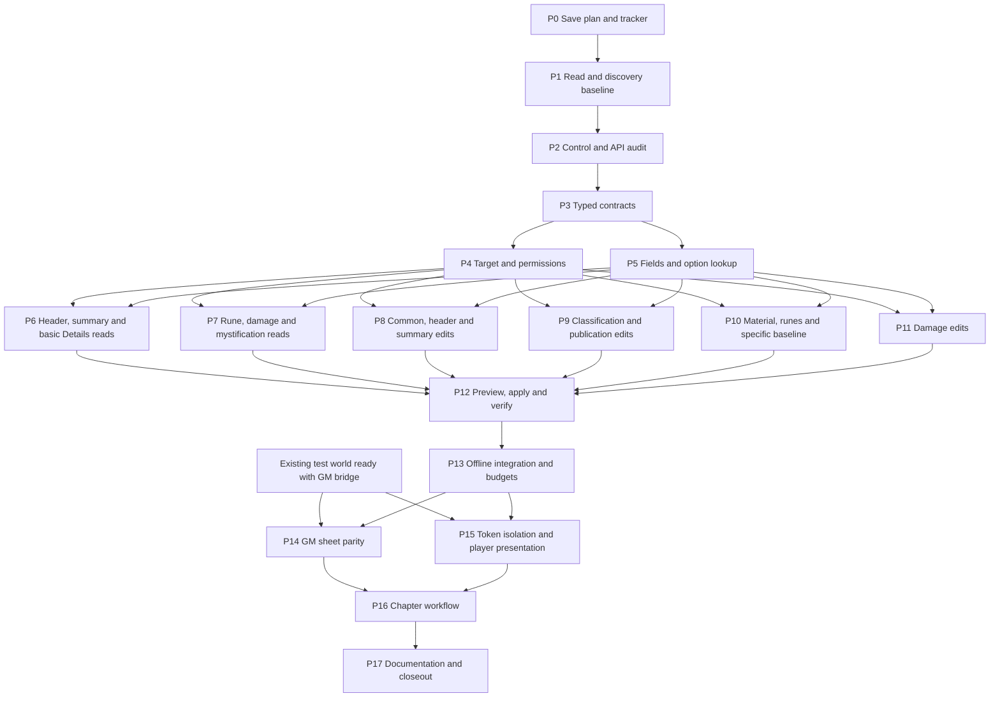

# PF2e Item editing and the weapon Details sheet

## Build handoff

This is the authoritative implementation plan. **Before starting implementation, save this plan and the [work tracker](../item-editing-tracker.md) in the checkout.** Carry both with the branch. At startup, after every context compaction, and when resuming on another machine, re-read both files in full. Reconcile them with Git history, the working tree, verification evidence and subsequent user instructions. Resume the next unfinished dependency-ready task. Recover a missing plan before continuing dependent work. Include both repository-relative paths in every handoff.

The deliverable is a GM-only tool for modifying one existing Item, plus a selective Item reader and choice discovery that use the GM's sheet vocabulary. A GM should be able to ask “What is the first property rune?” or “Set the first property rune to Wounding” using the same conversation. A separate use case is writing spoiler-free unidentified names and descriptions directly onto loot.

## What the GM and the LLM see

For a PF2e weapon, present these groups in the order below, with localized GM labels and stable machine field IDs. Include the visible header and sidebar. This inventory covers the supplied melee-weapon screenshot. Other physical Item types get the common authoring and mystification support below. Their distinct Details tabs and weapon-only panels absent from the screenshot, such as ammunition and combination-weapon alternate usage, are outside this increment. Account for their existing data when a proposed change affects applicability.

| Group | Read and edit surface | Behavior to prove |
| --- | --- | --- |
| Header | Source artwork, name, Item level, rarity, traits | Distinguish the sheet title/display name from the stored name input. Show displayed level, rarity and traits alongside authored values where PF2e adjusts them. Accept an existing image selector from the Foundry image browser for an artwork change. Distinguish granted traits such as rune-derived Magical from editable source traits. |
| Weapon Summary | Quantity, Hands, Bulk, Size, Price | Hands is weapon usage (0, 1, 1+, 2). Bulk offers the sheet's choices, including Negligible and Light. Price uses denomination amounts and its per-quantity basis. Show the displayed price of the Item separately from the editable source price and stack quantity. |
| Details | Category, Group, Base, Range | Return labels such as Martial Weapon, Sword, Dogslicer and None (Melee) with their codes. Respect field-specific blanks, increments and restrictions from group/traits. |
| Precious Material and Runes | Precious Material and its grade, Potency Rune, Striking Rune, ordinal Property Rune slots, Specific Magic Weapon | Accept a valid weapon material/grade pair. Retain slot order and distinguish free, occupied, derived and locked slots. The specific checkbox enables/disables PF2e's baseline of source material and runes. The writer owns that mapping. |
| Damage | Base dice count, die size and damage type, Splash amount, Persistent amount, die faces or flat damage, and type | Show source dice and adjusted display dice. Base and persistent damage have different type menus. A blank persistent die denotes flat damage. Clearing persistent damage clears the composite record. An etched property rune and a stored persistent damage entry are independent. |
| Other Tags | Weapon Other Tags | Present the applicable tag picker with its own vocabulary. Keep these tags separate from the header traits. |
| Publication | Title, Author(s), License, Remaster? | Title and authors are text. License is exactly `OGL` or `ORC` on the examined release. Remaster is a strict boolean independent of license. |
| Description and Mystification | Source description, identification status, unidentified display name and unidentified description | Edit the text independently of status. Preserve the alternate image and true details on a mystification-only edit. A reveal must restore the identified presentation. |

Use the following field IDs under their group. They identify controls in sheet reads, choice lookup and typed change objects. `display_name` is read-only. The date/version audit in P2 may correct a source mapping while keeping these user-facing IDs stable.

| Group ID | Field IDs |
| --- | --- |
| `header` | `image`, `name`, `display_name`, `level`, `rarity`, `traits` |
| `weapon_summary` | `quantity`, `hands`, `bulk`, `size`, `price` |
| `details` | `category`, `group`, `base`, `range` |
| `material_and_runes` | `precious_material` (type and grade), `potency_rune`, `striking_rune`, `property_runes` (slot and value), `specific_magic_weapon` |
| `damage` | `base` (dice, die, type), `splash`, `persistent` (amount, faces, type) |
| `other_tags` | `tags` |
| `publication` | `title`, `authors`, `license`, `remaster` |
| `description` | `text` |
| `mystification` | `identification_status`, `unidentified_name`, `unidentified_description` |

Field filters and option lookups use qualified semantic IDs such as `damage.base.type` and `publication.license`. A slot lookup also takes its ordinal. Use integer dice counts and slot numbers, stable PF2e codes for catalog choices, and JSON booleans for checkboxes. Clearing a slot uses `{"slot":1,"value":null}`. A compound edit can supply just the changed leaves on an existing record. Validate its complete resulting value. Setting a whole clearable record such as `damage.persistent` to null explicitly removes it. The writer must preserve unsupplied siblings, including the stored damage modifier that the screenshot does not expose.

**Rules-tab boundary.** UUID and Source ID may provide identity/provenance. The tool writes only the semantic fields above. Its input has no entry point for UUID, Source ID, slug, roll options, rule elements, flags, document type, arbitrary paths, embedded document arrays or raw update JSON. The Rules screenshot is a boundary reference. Existing read-only rule evidence remains available through existing reader selections. Rune selections belong to Details.

### Evidence to carry forward

- Planning used the existing Foundry 14.370 container, installed PF2e 8.7.0 schema, upstream Item definitions, and private PDF tools. The local MCP service and container were healthy. The dedicated browser reached the existing test world's migration prompt before GM login. Live write, player presentation and token-isolation results remain pending. Keep the previous approval requirement for a world migration. Complete independent offline work while it is pending.
- The existing readers already select weapon category/group, runes, damage, tags, publication, physical usage, material, size, Bulk, quantity and price. Reuse these selections. The gaps include sheet grouping, exact GM labels, source artwork, adjusted display values, specific-weapon checkbox semantics, slot context, field applicability and discoverable valid choices. Compare actual MCP output field by field before adding extraction. [Weapon audit](../actor-item-story-map/weapon-fields.md), [physical Item audit](../actor-item-story-map/physical-fields.md), [selective contract](../selective-reads.md)
- The pinned weapon schema declares required Hands usage codes, nullable range, typed damage records, ordered property runes, and the nullable specific material/runes snapshot. The installed sheet shows usage separately from equipped hands, filters bleed out of base damage, and can display adjusted dice, price and level. Use the screenshot and installed templates only as references for parity. Production uses public Foundry document operations and PF2e-supported schemas and interfaces. Each dependency needs a pinned source, public status and a version test. [Weapon data](https://github.com/foundryvtt/pf2e/blob/52dfeee703b887237f5e454747bcae45b136f9af/src/module/item/weapon/data.ts), [weapon choices](https://github.com/foundryvtt/pf2e/blob/52dfeee703b887237f5e454747bcae45b136f9af/src/module/item/weapon/values.ts), [physical data](https://github.com/foundryvtt/pf2e/blob/52dfeee703b887237f5e454747bcae45b136f9af/src/module/item/physical/data.ts), [Foundry Document API](https://foundryvtt.com/api/v14/classes/foundry.abstract.Document.html)
- Player Core p. 230 (physical 231) and GM Core p. 54 (physical 55) cover identification. GM Core pp. 220, 224–225 (physical 221, 225–226) distinguish activation, rune configuration and rune transfer. Player Core 2 p. 273 (physical 274) distinguishes alchemical consumables from magical gear. The upstream Dogslicer and Wounding entries demonstrate why a GM must inspect the owned weapon as well as its base template. Changing a document's configuration performs no Craft, identification check or transfer. [Dogslicer](https://github.com/foundryvtt/pf2e/blob/52dfeee703b887237f5e454747bcae45b136f9af/packs/pf2e/equipment/dogslicer.json), [Wounding](https://github.com/foundryvtt/pf2e/blob/52dfeee703b887237f5e454747bcae45b136f9af/packs/pf2e/equipment/wounding.json), [PF2e GM's guide](https://github.com/foundryvtt/pf2e/wiki/GM%27s-Starter-Guide)

## MCP contracts

1. **Read a sheet.** Extend `read_item` with an explicit `sheet` selector. For example, `read_item(item_uuid=…, sheet={groups:["material_and_runes","damage"]})`. Empty `sheet={}` selects the applicable groups in sheet order. Publish the stable group keys `header`, `weapon_summary`, `details`, `material_and_runes`, `damage`, `other_tags`, `publication`, `description` and `mystification`. Support a field filter within selected groups. Long descriptions require an explicit group or field request. The sheet selector is mutually exclusive with legacy `select` and `sections`. Preserve current default identity reads and existing callers, including journal, party, token and compendium follow-ups. Use a separate discriminated typed sheet response and test existing and new discovery schemas through FastMCP. Document the selector in `read_item`, `edit_item` and returned follow-ups.
2. **Return a form the client can use.** Each selected field carries its group, stable field ID, GM label, source presence/value, displayed value/label where available, and editability with a reason. Expose adjusted values with their basis. Inspect public source and transformed serialization or specifically verified PF2e public model fields. A missing display witness gets an explicit unavailable reason. Never substitute source or invented calculations for an adjusted display. Use one-based ordinals for rune slots. Supply a ready-to-call option lookup for choice controls. Paginate fields, repeated slots and exact text fragments with the existing 10-entry/8,000-byte defaults and 48,000-byte maximum. Bind cursors to canonical context, selections, bounds, locale and revision.
3. **Discover choices before guessing.** Add `get_item_field_options(item_uuid, token_uuid?, field, proposed_changes?, query?, limit?, max_bytes?, cursor?)`. Return paged canonical values with GM labels, availability, and explicit clear/unset semantics. Filter by a literal case-insensitive substring on code or localized label. Describe which fields accept free text, strict numbers, currency, a boolean, a compound value or a finite choice in discovery. Resolve dynamic choices against the actual target. Optional typed `proposed_changes` supplies prospective dependencies, e.g. the new potency for a slot lookup. Use the same evaluator as preview/apply. Bind continuation to these inputs and current choice context. A blank choice must be represented distinctly from a missing field. Keep large rune, base weapon and trait lists out of routine reads and global tool descriptions.
4. **Edit the same controls.** Publish `edit_item(item_uuid, token_uuid?, changes, mode="preview", expected_revision?)`. Use typed nested changes keyed by the same groups and field IDs, including `material_and_runes.property_runes` as ordered slot assignments with explicit one-based slots and a clear operation. Omission preserves a field. Permit explicit clearing only on named clearable controls. Preview returns compact per-field changes with GM labels, source before and proposed after, target identity/context, and a revision. It performs zero writes. Apply requires the same normalized proposal and preview revision. Return `applied` or `unchanged` plus a selective readback call. Bound preview and receipt sizes before writing, with bounded excerpts for prose and full text available through `read_item`. An oversize proposal gets a pre-write error with recovery.
5. **Validate before persistence.** Use strict Pydantic models in both directions and validate again inside the GM browser. Reject unknown keys at every level, arbitrary paths, invalid scalar types, ambiguous labels as selectors, stale/unavailable options, invalid ranges, duplicates or holes in slots, and invalid final combinations. Prefer enums for small fixed domains. For large or world-dependent domains use authoritative choices on the target. Where the release schema publishes a fixed domain with no external runtime accessor, use a version-pinned, reviewed catalog of public schema values. Bind localization only to presentation. Never infer allowed values from existing Items, scraped sheets, or a permissive string field. Include PF2e-supported world choices when a verified public contract exposes them. Retain unknown historical values on reads and unrelated edits. If validity cannot be established, reject the affected edit with a field-specific reason and lookup/reload instructions. A single invalid field rejects the entire proposal with zero updates.
6. **Validate dependent changes together.** Merge requested fields onto detached source for validation. Check material/grade compatibility, actual slot capacity (including material, variant settings and specific-weapon restrictions), sequential slots, rune category, damage choices, size, legal Hands usage, range restrictions, traits and conditional controls. Check the final proposal independently of input key order. Capacity reduction that would lose an occupied slot requires explicit removal in the same proposal. An enabled specific-weapon checkbox snapshots the validated source material/runes. Disabling clears that baseline. Enforce specific-weapon restrictions on subsequent edits. Validate a complete persistent-damage tuple or an explicit clear. Normalize price through structured pp/gp/sp/cp amounts without rewriting the price basis. Validate image references using existing permitted Foundry image selection and membership logic. Recompute applicable options before apply. Do not silently clamp invalid input, discard existing values or copy calculated results back to source.
7. **Persist exactly one Item.** Reuse the reader's canonical UUID/token resolver, then check exact membership, runtime, ready GM and public document update permissions. Support standalone world Items, Items on eligible world Actors, and actual Items on eligible unlinked Scene Tokens. Linked tokens share an inventory and receive a follow-up targeting the shared Actor's Item. Compendium Items remain readable research targets. Reject attachments, generated strikes, and identifiers from the Rules tab as write substitutes. Use public `Item.update` for standalone Items and the exact resolved Actor's `updateEmbeddedDocuments` for one embedded Item. Re-resolve and recheck after serializing by owner/standalone Item. Bind revisions to world, owner/token, source, proposal and relevant choice dependencies. Keep Foundry/PF2e hooks active. Re-read persisted fields before reporting success. A post-dispatch timeout or unverifiable result requires reconciliation with `read_item` before retry. Document the race with external Foundry clients after the final check. Avoid any automatic compensating write.
8. **Retain the first plan's common scope.** Across the nine physical Item types, support source name/description, identification status, unidentified name/description, and positive absolute quantity (1–999,999, except backpacks). Initialize a missing/null alternate record with both new display strings and the schema-default image. Preserve existing alternate images. Editing text alone preserves status. Text accepts plain prose, up to 256 Unicode code points for names and 2,000 for descriptions, escapes HTML and excludes executable inline notation. Empty alternate description clears the override. Update only the fields requested. Common groups use the same identifiers across types and explicitly report unsupported weapon sections. Qualify new writes on Foundry 14.370/PF2e 8.7.0 initially, as in the prior plan. Retain existing reader compatibility. Creation, deletion, activation, rolls, chat and transfers have no tool operation.

### Example of the shared interface

A sheet read on the GM's example should distinguish the title **Jagged Goblin Blade**, the stored header name **Dogslicer**, and the ordered weapon configuration **Weapon Potency (+1)**, **Striking**, **Property Rune (1st) — Wounding**. The GM sees **2d6 Slashing**, **440 gp** and **Item 7**. Obtain each stored base value separately. The screenshot alone cannot establish those source values. The Persistent control can be empty even when the Wounding property rune is present.

An illustrative preview for an eligible slot, after obtaining the canonical Item and token selectors, is:

```json
{
  "item_uuid": "<owned Item UUID from discovery>",
  "token_uuid": "<unlinked token UUID from discovery>",
  "mode": "preview",
  "changes": {
    "material_and_runes": {
      "property_runes": [{"slot": 1, "value": "wounding"}]
    }
  }
}
```

An occupied slot already holding Wounding produces a no-op. Unavailable slots return the reason. A mystification-only proposal supplies `mystification.unidentified_name` and `mystification.unidentified_description`; status is optional. Applying either proposal uses its own returned revision.

## Sized build sequence

The 18 tasks total 88 points on the 1, 3, 5, 8, 13 estimation scale. Read projection, validation and persistence have been split into separately verifiable tasks. The largest executable task is 8 points. The tracker owns status and evidence. This table owns scope, dependencies and acceptance.

| ID | Points | Depends on | Deliverable and acceptance |
| --- | ---: | --- | --- |
| P0 | 1 | — | Save the complete plan and initialize the tracker before code work. Verify both files and their links. |
| P1 | 3 | P0 | Capture actual discovery/schema size and representative existing source, description/evidence and complete paginated Item reads. Fix call/time budgets. Record runtime and fixture prerequisites. |
| P2 | 5 | P1 | Produce a control-by-control matrix for the two screenshots, existing reader coverage, source/display paths, schema choices, clears, dependencies, ownership and Rules exclusions. Establish public API/source references and identify every missing projection. |
| P3 | 5 | P2 | Publish strict typed sheet, choice and edit contracts with examples, stale/error recovery and legacy compatibility tests. Test FastMCP discovery and rejection of unknown input/output fields before persistence is available. |
| P4 | 5 | P3 | Implement shared target resolution, permissions and exact membership checks. Cover standalone, Actor, party stash, loot, linked and unlinked tokens, wrong token, pack, nested and generated cases. |
| P5 | 5 | P3 | Implement the stable control IDs, localized labels, domain lookup and paginated option RPC. Prove fixed and world-aware choice lookup, empty results, query, context revision and stale cursor behavior. |
| P6 | 5 | P4, P5 | Implement sheet reads for header, summary, category/group/base/range, Other Tags and Publication. Test every displayed control and its source witness, plus adjusted vs source price, level and traits. |
| P7 | 5 | P4, P5 | Implement sheet reads for material, runes, specific baseline, base/splash/persistent damage, common description and mystification. Test absent/empty/zero, adjusted dice, slot ordinals and bounded prose reconstruction. |
| P8 | 5 | P4, P5 | Implement common edits, mystification and the editable weapon header/sidebar. Verify usage vs equipped hands, existing image selection, price denominations, Bulk, level, traits, quantity, null alternate initialization and true/alternate preservation. |
| P9 | 5 | P4, P5 | Implement category/group/base/range, Other Tags and Publication edits. Exercise contextual menus, unsupported combinations, OGL/ORC, false Remaster, old unknown codes and arbitrary-key rejection. |
| P10 | 8 | P4, P5 | Implement material/grade, fundamental and ordered property runes, and specific-weapon checkbox behavior. Prove prospective capacity, invalid combinations, baseline transitions, explicit clearing and preservation of adjacent slots. |
| P11 | 5 | P4, P5 | Implement base, splash and persistent damage edits. Cover valid dice and type domains, base/persistent differences, flat vs dice vs cleared persistent damage, adjusted striking dice, zero and independent rune effects. |
| P12 | 8 | P6–P11 | Wire preview/apply to one permission-checked public update and readback. Cover all-or-nothing validation, post-dispatch uncertainty, concurrency, no-ops, stale sources/options and bounded receipts. |
| P13 | 5 | P12 | Run focused suites and full offline regression outside the sandbox. Validate actual tools/list and tools/call, unrelated reader follow-ups, rejection cases and payload budgets against P1. |
| P14 | 5 | P13, GM bridge | Verify sheet read/option parity and write/read/reload on marked standalone and Actor-owned fixtures. Compare each control with the GM sheet, including adjusted displays and editor-enabled states. Confirm sibling fields, Rules source and owner inventory membership after edits. |
| P15 | 5 | P13, GM bridge | Verify an unlinked loot/NPC Item across reload, base Actor and sibling token isolation, linked-target recovery, and the ordinary player's unidentified/identified presentation. Verify exact fixture cleanup. |
| P16 | 5 | P14, P15 | Exercise the chapter-sweep workflow through public MCP discovery on a bounded multi-room fixture. Reconcile inventory coverage and output the five-column private GM report. |
| P17 | 3 | P16 | Document the interface, examples, source vs display, compatibility, verification, and client refresh in detailed docs. Update the public README and Docker Hub overview briefly. Close the tracker with measured evidence and remaining environment limitations. |



## Verification and delivery

- Test the allowlist in both directions. Every screenshot control must have a reader assertion and, where editable, an accepted update and a rejected invalid proposal. Include bogus material, real material at an invalid grade, an armor rune proposed for a weapon, out-of-domain potency/striking, slot overflow, an unknown damage type, bleed as base vs persistent, an unknown license, invalid usage/size/range/tag, a rule element disguised as a nested edit, and a mixed valid/invalid request. Count persistence calls. Test runs must prove invalid proposals perform zero updates and valid multi-field proposals perform one. Keep malformed or historical source readable without legitimizing it for new assignments.
- Exercise omitted/null/empty/value, adjusted/source equality and divergence, multiple simultaneous edits, and exact re-read after refresh. Test independent edits made between preview/apply, including changed Actor/world-dependent choices. Verify selected default, one field, all screenshot fields, choice search, a complete paginated catalog, expanded text and a preview/apply/read workflow. Measure calls, catalog size, compact UTF-8 JSON bytes and completion. Increase limits explicitly up to 48,000 bytes for reads; keep write receipts at or below 8,000 bytes. Preserve source/provenance in dedicated reads. [MCP evaluation](../mcp-tool-evaluation.md)
- Follow repository test and dev-loop instructions. Use marked fixtures only in the existing local test world after offline checks. For a specific-weapon fixture, exercise on/off and the material/rune baseline. Verify a change of rune tier reports its real displayed consequences through PF2e. Record unsupported display access or a disagreement with the GM sheet against its individual control. Keep that task open until the required control is delivered or the GM explicitly narrows scope.
- For the chapter example, enumerate journal/room evidence, relevant scenes, NPCs and loot Actors; exhaust all pages and inspect actual possessions. Include magic evidenced by runes or relevant compendium definitions, not just an Item name or a single trait filter. Deduplicate writes to shared Items while retaining all evidenced locations. Distinguish per-token copies and report unresolved room/Actor assignments. Around 20 Items is a reasonableness check. Author sensory clues without rule names, numerical bonuses or explicit effects. Verify each successful write. Produce a GM-only table with **Location, Actor, Identified Item Name, Unidentified Name, Description**. If PF2e generates an identified name, use documented verified presentation where available and mark reconstructions. Keep real campaign IDs, inventories, screenshots, private PDF content and credentials outside tracked files.
